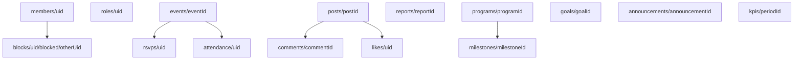

# Data model

One Firestore database per environment, holding one chapter. TypeScript types for every document live in `src/data/types.ts`. Security rules are in `firestore.rules` and `storage.rules`, with tests in `tests/rules/`.

## Who can do what

| Person          | How the rules know                                       |
| --------------- | -------------------------------------------------------- |
| Signed-in user  | `request.auth != null`                                   |
| Approved member | `members/{uid}.status == 'approved'`                     |
| Officer         | approved, and `roles/{uid}.role` is `officer` or `admin` |
| Admin           | approved, and `roles/{uid}.role == 'admin'`              |

Nobody sees chapter data until an officer approves their membership. Roles live in their own collection that only admins can write, so a member can never promote themselves. Cloud Functions use the Admin SDK and aren't limited by these rules.

The first admin is set by hand: create `roles/{uid}` with `{ role: 'admin' }` in the Firebase console (or with the seed script, #7).

## Collections

| Path                                            | What it holds                               | Read                                                        | Write                                                                                                                        |
| ----------------------------------------------- | ------------------------------------------- | ----------------------------------------------------------- | ---------------------------------------------------------------------------------------------------------------------------- |
| `members/{uid}`                                 | Profile and membership status               | Approved members; the person themself; officers             | The person creates it as `pending` and edits profile fields only. Officers change `status`. Admins can delete                |
| `roles/{uid}`                                   | `officer` or `admin`, plus an officer title | The person themself; approved members (to show role badges) | Admins only                                                                                                                  |
| `events/{eventId}`                              | Event details                               | Approved members                                            | Officers                                                                                                                     |
| `events/{eventId}/rsvps/{uid}`                  | Going, maybe or not going                   | Approved members                                            | The member, for themself, until the RSVP deadline                                                                            |
| `events/{eventId}/attendance/{uid}`             | Officer check-in and service hours          | Officers; the member for their own record                   | Officers                                                                                                                     |
| `posts/{postId}`                                | Photo post                                  | Approved members (removed posts: author and officers only)  | Approved members who accepted the guidelines create their own. Authors edit the caption or delete. Officers remove or delete |
| `posts/{postId}/comments/{commentId}`           | Comment                                     | Approved members                                            | Approved members create their own if comments are on. Authors or officers delete                                             |
| `posts/{postId}/likes/{uid}`                    | Like                                        | Approved members                                            | The member, for themself                                                                                                     |
| `reports/{reportId}`                            | Report of a post or comment                 | Officers                                                    | Approved members create; officers resolve                                                                                    |
| `blocks/{uid}/blocked/{otherUid}`               | Someone this member blocked                 | The member only                                             | The member only                                                                                                              |
| `programs/{programId}`                          | Annual program                              | Approved members                                            | Officers                                                                                                                     |
| `programs/{programId}/milestones/{milestoneId}` | Program milestone                           | Approved members                                            | Officers                                                                                                                     |
| `goals/{goalId}`                                | Chapter-defined goal                        | Approved members                                            | Officers                                                                                                                     |
| `announcements/{announcementId}`                | Officer announcement                        | Approved members                                            | Officers                                                                                                                     |
| `kpis/{periodId}`                               | Computed metrics for a period               | Officers                                                    | Cloud Functions only                                                                                                         |

Anything not listed is denied.

## Storage

| Path                          | Read             | Write                                                      |
| ----------------------------- | ---------------- | ---------------------------------------------------------- |
| `avatars/{uid}/{file}`        | Approved members | The person themself. Images only, up to 5 MB               |
| `posts/{uid}/{postId}/{file}` | Approved members | The person themself, if approved. Images only, up to 10 MB |
| `events/{eventId}/{file}`     | Approved members | Officers. Images only, up to 10 MB                         |

## Key fields and limits

- Member `status`: `pending`, `approved` or `declined`
- RSVP `status`: `going`, `maybe` or `not_going`
- Report `reason`: `spam`, `harassment`, `inappropriate` or `other`. Report `status`: `open`, `kept`, `removed` or `restricted`
- Program and goal `status`: `not_started`, `in_progress`, `at_risk` or `completed`
- Bio up to 150 characters, caption up to 2,200, comment up to 1,000, up to 10 photos per post
- Timestamps use Firestore server timestamps
