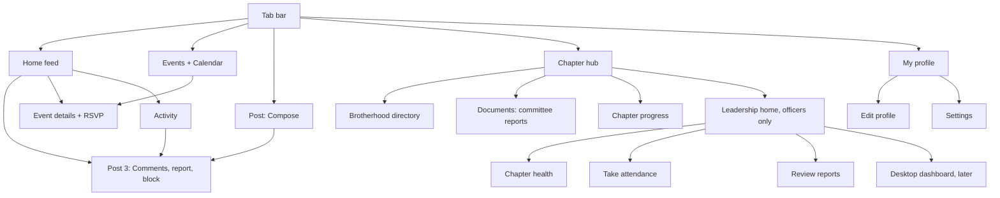

# Screen map

Every screen in the design canvas, what it does, and the issues that build it. Canvas (private): https://claude.ai/artifact/HCycq4MqBnbSJsFLUwqacV

All names and figures in the mockups are sample data.

## Navigation

## Getting in

| Screen                                   | What it does                                                                                                                                                                                                                                                                                                                                                                                                                                                                                                                                           | Issues |
| ---------------------------------------- | ------------------------------------------------------------------------------------------------------------------------------------------------------------------------------------------------------------------------------------------------------------------------------------------------------------------------------------------------------------------------------------------------------------------------------------------------------------------------------------------------------------------------------------------------------ | ------ |
| Welcome                                  | Swipeable intro, four pages with page dots and Skip: the chapter, the feed, events and check-ins, private to brothers. Create account and Sign in below.                                                                                                                                                                                                                                                                                                                                                                                               | #9     |
| Sign up                                  | One question per screen with step progress and Back: name, when you crossed (season and year), then About you, each skippable: industry chips and job title, businesses owned (up to 3), interests (suggested chips or your own), a profile photo (Skip for now); then email and a password, and a final Review your information (photo, name, line, work, businesses, interests, email; tap any to change it) with Create account. The photo uploads once the account exists with its rules ticked off as you type. Continue sits above the keyboard. | #9     |
| Review your information (no profile yet) | Only when the account was made but its profile didn't save. With this sign up's answers still on the phone (in memory only, never the password): a read-only review and Send request. Otherwise the sign up questions again without email and password (name prefilled), ending in the same review with Send request.                                                                                                                                                                                                                                  | #11    |
| Check your email                         | Mail illustration, the address the link went to, Open Mail (iOS), I've verified, Resend. Shows the way in: account created, confirm your email, officer approval.                                                                                                                                                                                                                                                                                                                                                                                      | #10    |
| Waiting for approval                     | Greets the brother by first name and shows the way in with officer approval under way, plus what he submitted. Opens the chapter on its own once approved.                                                                                                                                                                                                                                                                                                                                                                                             | #11    |

## Member app

| Screen               | What it does                                                                                                                                                                                                                                                                                                                                                                                                                                                                                                                                                                                                                      | Issues        |
| -------------------- | --------------------------------------------------------------------------------------------------------------------------------------------------------------------------------------------------------------------------------------------------------------------------------------------------------------------------------------------------------------------------------------------------------------------------------------------------------------------------------------------------------------------------------------------------------------------------------------------------------------------------------- | ------------- |
| Home feed            | Top bar: plus for a new post, ΣΣΛ monogram, heart for Activity. A welcome card for new brothers (add a photo, add your initiation date, see your check-in code) until done or closed. Line anniversaries this week (from members' initiation dates) at the top when there are any. Instagram-style posts with like, comment, share, save. Official chapter posts get a gold check badge and can carry an event card with RSVP. When an officer approves a new brother, a Cloud Function posts an official welcome by that officer that tags him, with his line, work and businesses (once per brother; deleted with his account). | #29, #30, #39 |
| Activity             | Behind the heart at the top of Home (a dot means something new). Likes, comments and replies on your posts, posts you're tagged in, new announcements, event reminders and your approval; New then Earlier, likes on a post grouped. Chapter notices show the monogram. Tap to open the post, comments, event or Chapter.                                                                                                                                                                                                                                                                                                         |               |
| Events + Calendar    | Plus for a new event, search, Upcoming and Calendar segmented control, featured next event, rows with RSVP state and coverage ("6 of 10 brothers · 60%") for events that need a number of brothers. Calendar has gold dots on event days; tapping a day lists its events.                                                                                                                                                                                                                                                                                                                                                         | #20, #21      |
| Event details + RSVP | Hero photo, title, host, RSVP segmented control (Going, Maybe, Can't go) with confirmation text, date and place rows with Add and Directions, fee and deadline, coverage of the brothers needed, who's going, a photo album of posts from the event (tap opens the post), about.                                                                                                                                                                                                                                                                                                                                                  | #22, #23, #24 |
| New / Edit event     | One page in titled sections. What: photo, title, category. When: start, How long (No end time, 1, 2 or 3 hrs, Custom), RSVPs close (Until it starts, Day before, 2 days, Week before, Custom), and a sentence saying it back. Where: place, optional address for directions. Extras: Costs money and Need a number of brothers switches that show their fields, About. Create event or Save changes at the bottom too; saving with a problem scrolls to it. A new event can't start with RSVPs already closed.                                                                                                                    | #27           |

## Posting flow

| Screen                          | What it does                                                                                                                                                                                                                                                                                                                                                                                                                                                                                                                                                                                                                                                                                                                                                                                       | Issues             |
| ------------------------------- | -------------------------------------------------------------------------------------------------------------------------------------------------------------------------------------------------------------------------------------------------------------------------------------------------------------------------------------------------------------------------------------------------------------------------------------------------------------------------------------------------------------------------------------------------------------------------------------------------------------------------------------------------------------------------------------------------------------------------------------------------------------------------------------------------- | ------------------ |
| Post: Compose                   | Three steps, Instagram style. 1. Photos: the Post tab opens straight to the camera roll (Recents grid, camera tile first, tap to pick up to 10 in order; picked photos show above it, tap one to edit it or remove it). Without photo access: Allow or Settings, plus the system picker. Next opens the editor, or with no photos goes straight to the caption for a text post. 2. Edit photos: post shape Original, 1:1, 4:5 or 16:9, pinch to zoom and drag to frame, make cover; Back keeps the framing, Next goes on. 3. Caption: the photos in order, caption with the guidelines link under the count, tag event, tag brothers, allow comments, visible to members only. Back keeps what was written. Share shows upload progress, then a Posted sheet. The feed shows posts at their shape. | #31, #32, #33, #38 |
| Post 3: Comments, report, block | Full post, likes on post and comments, comment input. The ... menu opens Report (pick a reason, then confirm), Block (confirm first) and Copy link.                                                                                                                                                                                                                                                                                                                                                                                                                                                                                                                                                                                                                                                | #34, #35, #36, #37 |

## Profile flow

| Screen       | What it does                                                                                                                                                                                                                                                                                                                                                                                                                                                                                                                                                                                                                                                                                                                                                                                                                                                                                                                                      | Issues   |
| ------------ | ------------------------------------------------------------------------------------------------------------------------------------------------------------------------------------------------------------------------------------------------------------------------------------------------------------------------------------------------------------------------------------------------------------------------------------------------------------------------------------------------------------------------------------------------------------------------------------------------------------------------------------------------------------------------------------------------------------------------------------------------------------------------------------------------------------------------------------------------------------------------------------------------------------------------------------------------- | -------- |
| My profile   | Photo with gold ring, counts for posts, events and service hours, name, headline, initiation, bio, "Works in" industry, "Lives in" city and "Owns" businesses lines, interest tags. Photos tab (square grid, photo posts only), Text tab (posts without photos, each with the member's photo, name and when), Tagged tab (posts others tagged them in) and Activity tab: Coming up (events they RSVP'd Going to), then Recent, newest first (check-ins with service hours, posts shared, posts they were tagged in, initiation and line anniversaries); each event or post row opens it. Your own profile has a Check-in code button with a QR code officers scan. Tapping a post opens it, staying in the Profile or Chapter tab. Every brother sees anyone's post, event and service hour counts; which events someone attended (check-ins in the Activity tab) is visible only to the member and officers; everyone sees the rest of Activity. | #13, #18 |
| Edit profile | iOS-style form: name, headline, bio with 150 character count, initiation term and optional initiation date (for line anniversaries), chapter role (locked, set by officers), industry chips, businesses you own (up to 3), city (optional, like Atlanta, GA; never an exact location), interests (suggested chips or your own), show email and show phone switches.                                                                                                                                                                                                                                                                                                                                                                                                                                                                                                                                                                               | #14      |
| Settings     | Account and membership status, notification switches, privacy, blocked accounts, guidelines, support contact, and the terms and privacy policy (static pages shown in the app). Sign out and Delete account confirm first.                                                                                                                                                                                                                                                                                                                                                                                                                                                                                                                                                                                                                                                                                                                        | #15, #16 |

## Chapter flow

| Screen                | What it does                                                                                                                                                                                                                                                                                                                                   | Issues   |
| --------------------- | ---------------------------------------------------------------------------------------------------------------------------------------------------------------------------------------------------------------------------------------------------------------------------------------------------------------------------------------------- | -------- |
| Documents             | Committee reports. Submit one (committee, reporting period, summary, an optional PDF, Word file or photo); it's emailed to the VPs. Members see their own, officers see all with email status. Admins set the recipients.                                                                                                                      |          |
| Chapter hub           | Officers only: Leadership card at the top with a waiting count. Everyone: progress card (ring plus brother, officer and program counts), round shortcuts (Directory, Businesses, Programs, Calendar, Documents), announcements with unread dots that expand on tap, officer cards.                                                             | #42, #43 |
| Brotherhood directory | A to Z by last name, role badges, live search by name, job, industry, business or interest, filters (All, Officers, Mentors, recent initiates), then narrowing pills: Near me (once you've added your city), Industry, Interest, Line and City (each a list of what brothers actually have, with counts), Owns a business, Clear. Empty state. | #17      |
| Line page             | From "Initiated Spring 2019" under a name on any profile: everyone from that line, by last name, with a count. Your own name opens your profile.                                                                                                                                                                                               |          |
| Businesses            | From the Chapter shortcut: every brother-owned business A to Z with its owner and his industry, searchable, each opening the owner's profile. "Own a business? Add it" opens Edit profile.                                                                                                                                                     |          |
| Chapter progress      | Member view of programs grouped Needs help, On track, Completed. Tap to expand milestones. Needs help programs have an "I can help" button.                                                                                                                                                                                                    | #44, #45 |

## Leadership tools, mobile (officers only)

| Screen          | What it does                                                                                                                                                                                                                                                                                                                                                                                                 | Issues             |
| --------------- | ------------------------------------------------------------------------------------------------------------------------------------------------------------------------------------------------------------------------------------------------------------------------------------------------------------------------------------------------------------------------------------------------------------ | ------------------ |
| Leadership home | Period filter, goals ring, KPI tiles (participation, attendance, service hours, active members). Needs attention: reported posts, programs at risk, membership requests with inline approve and decline. Quick actions: take attendance, post announcement, create event, update milestone. Link to the desktop dashboard.                                                                                   | #46, #47, #48, #27 |
| Chapter health  | Officers only, from a row on Leadership home. The chapter year at a glance: a green, yellow and red bar with counts, milestones done, goals met and how much of the year is gone. Programs and goals listed worst first, each with its status and why. Green is on pace for the time of year; yellow is one milestone or up to 15 points behind; red is further behind, past due or flagged as needing help. | #58 (mobile)       |
| Take attendance | Checked-in count against RSVPs, Scan check-in codes (camera reads brothers' QR codes), search, RSVP'd vs all filter, tap to check in, add walk-in, log service hours switch, save confirmation.                                                                                                                                                                                                              | #49                |
| Review reports  | Report cards with reason, count and preview. Keep, Remove or Restrict (pause posting 7 days), each with undo. Reporters stay anonymous; decisions are logged.                                                                                                                                                                                                                                                | #50                |

## Officer desktop (later)

| Screen                   | What it does                                                                              | Issues   |
| ------------------------ | ----------------------------------------------------------------------------------------- | -------- |
| Chapter health dashboard | Sidebar, period filter, goals ring, needs attention, KPI cards, attendance trend chart.   | #58      |
| Annual programs + KPIs   | Program list or board, milestone checklist that recalculates percent complete, KPI cards. | #59, #60 |
