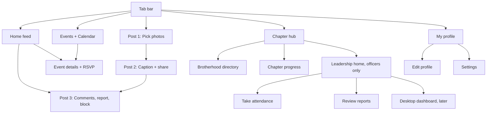

# Screen map

Every screen in the design canvas, what it does, and the issues that build it. Canvas (private): https://claude.ai/artifact/HCycq4MqBnbSJsFLUwqacV

All names and figures in the mockups are sample data.

## Navigation

## Member app

| Screen | What it does | Issues |
|---|---|---|
| Home feed | Upcoming events strip, Instagram-style posts with like, comment, share, save. Official chapter posts get a gold check badge and can carry an event card with RSVP. | #29, #30, #39 |
| Events + Calendar | Search, Upcoming and Calendar segmented control, category chips, featured next event, rows with RSVP state. Calendar has gold dots on event days; tapping a day lists its events. | #20, #21 |
| Event details + RSVP | Hero photo, title, host, RSVP segmented control (Going, Maybe, Can't go) with confirmation text, date and place rows with Add and Directions, fee and deadline, who's going, about, photos. | #22, #23, #24 |

## Posting flow

| Screen | What it does | Issues |
|---|---|---|
| Post 1: Pick photos | Grid picker, numbered multi-select up to 10, preview with page dots, Next disabled until something is picked, Camera and Text only. | #31 |
| Post 2: Caption + share | Caption, thumbnails with cover, tag event, tag brothers, visible to members only, allow comments switch, guidelines link. Share shows upload progress, then a Posted sheet. | #32, #33, #38 |
| Post 3: Comments, report, block | Full post, likes on post and comments, comment input. The ... menu opens Report (pick a reason, then confirm), Block (confirm first) and Copy link. | #34, #35, #36, #37 |

## Profile flow

| Screen | What it does | Issues |
|---|---|---|
| My profile | Photo with gold ring, counts for posts, events and service hours, name, headline, initiation, bio, interest tags. Posts grid tab and Activity tab. Attendance is visible only to the member and officers. | #13, #18 |
| Edit profile | iOS-style form: name, headline, bio with 150 character count, initiation, chapter role (locked, set by officers), interests, show email and show phone switches. | #14 |
| Settings | Account and membership status, notification switches, privacy, blocked accounts, guidelines, support contact, terms. Sign out and Delete account confirm first. | #15, #16 |

## Chapter flow

| Screen | What it does | Issues |
|---|---|---|
| Chapter hub | Officers only: Leadership card at the top with a waiting count. Everyone: progress ring, tiles (Directory, Programs, Calendar, Documents), announcements with unread dots that expand on tap, officers row. | #42, #43 |
| Brotherhood directory | A to Z by last name, role badges, live search by name, job or interest, filters (All, Officers, Mentors, recent initiates), empty state. | #17 |
| Chapter progress | Member view of programs grouped Needs help, On track, Completed. Tap to expand milestones. Needs help programs have an "I can help" button. | #44, #45 |

## Leadership tools, mobile (officers only)

| Screen | What it does | Issues |
|---|---|---|
| Leadership home | Period filter, goals ring, KPI tiles (participation, attendance, service hours, active members). Needs attention: reported posts, programs at risk, membership requests with inline approve and decline. Quick actions: take attendance, post announcement, create event, update milestone. Link to the desktop dashboard. | #46, #47, #48, #27 |
| Take attendance | Checked-in count against RSVPs, search, RSVP'd vs all filter, tap to check in, add walk-in, log service hours switch, save confirmation. | #49 |
| Review reports | Report cards with reason, count and preview. Keep, Remove or Restrict (pause posting 7 days), each with undo. Reporters stay anonymous; decisions are logged. | #50 |

## Officer desktop (later)

| Screen | What it does | Issues |
|---|---|---|
| Chapter health dashboard | Sidebar, period filter, goals ring, needs attention, KPI cards, attendance trend chart. | #58 |
| Annual programs + KPIs | Program list or board, milestone checklist that recalculates percent complete, KPI cards. | #59, #60 |
